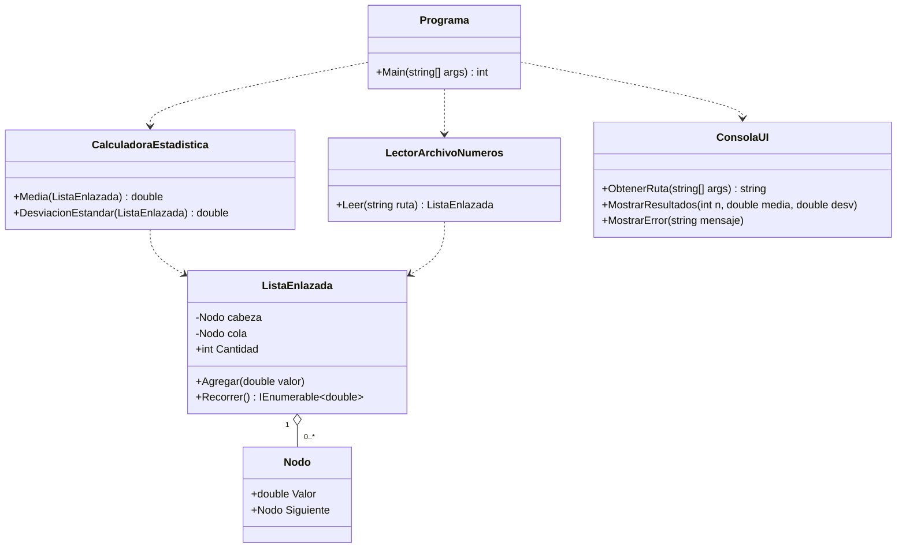
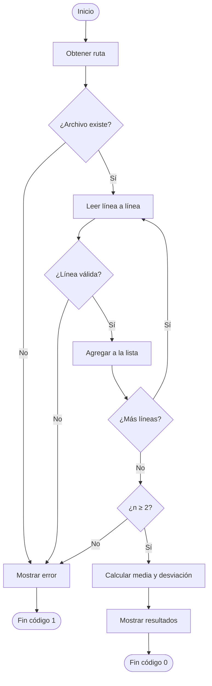

# Diagrama de clases, capas y actividad

## Clases



## Arquitectura en 4 capas

| Capa | Contiene | Depende de |
|---|---|---|
| Dominio | `Nodo`, `ListaEnlazada`, `CalculadoraEstadistica` | nada |
| Infraestructura | `LectorArchivoNumeros` (archivos) | Dominio |
| Presentación | `ConsolaUI` (entrada/salida por consola) | — |
| Aplicación | `Programa` (orquesta el flujo) | las tres anteriores |

Motivo: el Dominio no sabe de archivos ni de consola, así que se prueba con xUnit sin tocar disco, y se puede reutilizar.

**Sin base de datos:** el enunciado solo pide leer un archivo, calcular y mostrar; no hay que conservar datos entre ejecuciones.

## Estructura de carpetas
```
src/
  Dominio/            Nodo.cs, ListaEnlazada.cs, CalculadoraEstadistica.cs
  Infraestructura/    LectorArchivoNumeros.cs
  Presentacion/       ConsolaUI.cs
  Aplicacion/         Programa.cs
tests/                pruebas xUnit
```

## Diagrama de actividad


